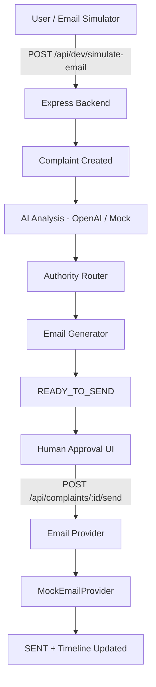

# ComplanX

> Your complaint. AI analyzed. Right authority notified.

ComplanX is an AI-powered complaint analysis and authority-routing platform. A user submits a complaint, the AI classifies it, identifies the right authority, generates a professional email, and sends it after human approval.

---

## Architecture



---

## Tech Stack

| Layer    | Tech                                      |
|----------|-------------------------------------------|
| Frontend | React, Vite, TypeScript, Tailwind CSS     |
| Backend  | Node.js, Express, TypeScript, Prisma      |
| Database | PostgreSQL                                |
| AI       | OpenAI GPT-4o-mini (mock fallback)        |
| Email    | MockEmailProvider (pluggable interface)   |
| Auth     | JWT + bcrypt                              |

---

## Project Structure

```
complanx/
├── client/          # React frontend
├── server/
│   ├── src/
│   │   ├── controllers/
│   │   ├── routes/
│   │   ├── services/
│   │   │   ├── ai/          # AI analysis (isolated)
│   │   │   ├── email/       # Email provider interface
│   │   │   ├── authority/   # Authority routing
│   │   │   └── complaint/   # Complaint business logic
│   │   ├── middleware/
│   │   └── server.ts
│   └── prisma/
│       ├── schema.prisma
│       └── seed.ts
├── .env
└── package.json
```

---

## Quick Start

### 1. Prerequisites

- Node.js 18+
- PostgreSQL running locally

### 2. Install dependencies

```bash
npm install
npm install --prefix client
npm install --prefix server
```

### 3. Set up environment

```bash
cp .env.example .env
# Edit .env — set DATABASE_URL, optionally set OPENAI_API_KEY
```

### 4. Set up database

```bash
npm run db:migrate    # runs prisma migrate dev
npm run db:seed       # seeds demo users + authorities
```

### 5. Run

```bash
npm run dev
```

- Frontend: http://localhost:5173
- Backend:  http://localhost:5000

---

## Demo Credentials

| Role  | Email                  | Password   |
|-------|------------------------|------------|
| User  | demo@complanx.app      | Demo@1234  |
| Admin | admin@complanx.app     | Demo@1234  |

---

## OpenAI Setup

Add your key to `.env`:

```
OPENAI_API_KEY=sk-...
```

If the key is not set, ComplanX uses a built-in mock analyzer that classifies complaints using keyword matching. The app is fully functional without an OpenAI key.

---

## Hackathon Demo (2 min)

1. Open http://localhost:5173
2. Log in as `demo@complanx.app` / `Demo@1234`
3. Go to **Email Simulator**
4. Click **Garbage** quick example, then **Simulate Incoming Email**
5. Watch the AI analysis result — category, location, confidence
6. See the recommended authority and generated email
7. Click **Approve & Send**
8. See the complaint timeline: Received → Analyzed → Sent

---

## Email Provider Architecture

The email system uses a pluggable interface:

```ts
interface EmailProvider {
  sendEmail(data: SendEmailData): Promise<EmailResult>;
}
```

Current: `MockEmailProvider` — stores in DB, logs to console.

To add Gmail/SMTP/Resend later, implement the interface and register in `emailProviderFactory.ts`. Zero changes to business logic.

---

## Future Improvements

- Real Gmail inbox integration via OAuth
- Automatic email ingestion from complaints@complanx.app
- WhatsApp / SMS notification
- Multi-language (Hindi/Punjabi) support
- Duplicate complaint detection
- Authority portal for status updates
- SLA tracking and escalation
- Mobile app
